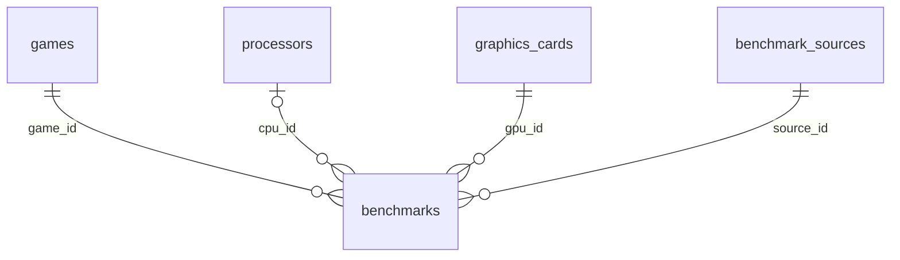

# SQLite: схема Backend v0.1

Миграция `003-game-fps-cap.sql` добавляет `games.fps_cap`: REAL, NULL либо положительное значение. Заполняется только явным положительным `engine_fps_cap` из CSV. Это метаданные источника, не определение ограничителя пользователя. После миграции запусти `npm run import:offline` при наличии скачанного кэша, чтобы заполнить поле у существующих игр. Импортированные FPS не меняются. Производные прогнозы вычисляются при запросе и не записываются в `benchmarks`. [Описание модели](FORECAST.md).

SQLite — локальная реляционная база, то есть данные хранятся в связанных таблицах. Код подключения: `src/db/database.js`; воспроизводимые миграции — `src/db/migrations/`. `schema_migrations` отмечает уже применённые SQL-файлы. Каждая миграция выполняется транзакционно.

| Таблица | Поля |
| --- | --- |
| games | id, name, slug, genre, description, release_date, rawg_id, image_url; дополнительно identity_key, steam_appid, page_url, edition_note, featured |
| processors | id, manufacturer, model, identity_key |
| graphics_cards | id, manufacturer, model, form_factor, identity_key |
| benchmark_sources | id, name, url, license, dataset_version, data_type |
| benchmarks | id, game_id, gpu_id, cpu_id, ram_gb, resolution_width, resolution_height, graphics_preset, ray_tracing_mode, upscaling_mode, frame_generation_mode, average_fps, one_percent_low, gpu_usage, cpu_usage, source_id, data_type, measured_at, imported_at, sample_count; дополнительно external_key, source_url, game_version, os, driver, conditions_json |

**PK** — первичный ключ (уникальный ID строки). **FK** — внешний ключ, ссылающийся на другую таблицу. Например, `benchmarks.game_id` указывает на игру. Связь по ID надёжнее повторения названия в каждой записи.

**NULL** означает «неизвестно/не сообщается», а не ноль и не «подходит всем». CPU и RAM для модельных оценок остаются NULL. Для измерения поиск требует точного CPU/RAM; NULL измерения никогда не становится универсальным совпадением.

**UNIQUE** ограничивает дубли: slug и identity_key игры; identity_key устройства; имя + версия источника; source_id + external_key результата. Новый снимок источника может хранить ещё одну версию той же записи, старая сохраняется.

**CHECK** ограничивает допустимые типы результатов, положительный FPS и разрешение, диапазон нагрузки 0–100%, положительное число повторов и объём RAM. Составной FK `(source_id,data_type)` не позволяет приписать модельной записи источник с типом measured.

Индексы ускоряют поиск по игре/GPU/разрешению/пресету, CPU/RAM, отдельному GPU и источнику. Параметры запросов передаются отдельно от SQL: строка пользователя не может стать SQL-кодом.

`conditions_json` хранит дополнительные известные сведения источника (тип/каналы памяти, тестовый стенд, способ захвата, исходный файл, credits), не заменяя основные индексируемые поля. Названия и численные сведения из него не достраиваются.

Режимы хранятся нормализованными строками: например, `off`, `fsr 2.1 auto`, либо NULL. RT High и пресет High — разные условия. 1% Low сохраняется с методикой источника, без пересчёта в собственную метрику.

Подключение включает `foreign_keys=ON`, WAL и busy_timeout 5000 ms. WAL помогает читать при записи; это не отменяет того, что большой импорт лучше запускать отдельно от сервера. Удаления/сброса рабочей базы скрипты инициализации и импорта не выполняют.
